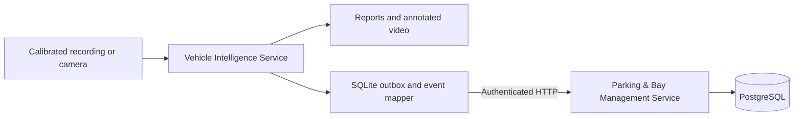

# SmartGarage-S1

Start with the [developer guide](docs/DEVELOPER_SETUP.md#automated-execution) for automated preview and full integration. See the [Windows runbook](docs/WINDOWS_RUNBOOK.md#full-integration-prerequisites) for PostgreSQL provisioning.

For a fresh verification run, use the [quick-test guide](docs/TESTING.md). Coding agents should start with [AI agent setup](docs/AI_AGENT_SETUP.md).

Before upgrading a database, read the [delivery integrity and migration notes](docs/DEVELOPER_SETUP.md#delivery-integrity-and-schema-upgrade).

SmartGarage processes camera or recorded parking footage and maintains parking state. **Vehicle Intelligence Service** (internal package: `vehicle_intelligence`) handles detection, tracking, optional ANPR, calibrated slot assignment and camera-side lifecycle. **Parking & Bay Management Service** (internal package: `parking_management`) receives and persists parking events and serves occupancy, session history and analytics.



Both services use Python and FastAPI. S1 uses OpenCV and Ultralytics. S2 uses SQLAlchemy and PostgreSQL.

| Directory | Responsibility |
| --- | --- |
| `vehicle_intelligence/vehicle_front` | Vehicle detection, tracking, identity, ANPR and attributes |
| `vehicle_intelligence/parking` | Geometry, tripwire, slot assignment, occupancy and lifecycle |
| `vehicle_intelligence/integration`, `vehicle_intelligence/events` | Vehicle-to-parking bridge, event construction and validation |
| `vehicle_intelligence/multicam`, `vehicle_intelligence/video` | Shared inference, independent camera state, capture and demo video |
| `vehicle_intelligence/publishing`, `vehicle_intelligence/reporting` | SQLite outbox, Service 2 mapping and reports |
| `vehicle_intelligence/common`, `vehicle_intelligence/api.py` | Configuration, logs, structured diagnostics and HTTP |
| `config`, `data`, `models`, `tests` | Configuration, geometry and local assets, model placement, regression suite |
| `parking_management` | Bundled Service 2 code and independently runnable tests |

## Fresh developer setup

Provision a local UTF-8 PostgreSQL login and export the values in [.env.example](.env.example). From the clone root, run this CPU setup with the bundled preview recording:

```bash
python scripts/setup.py --cpu-torch --config .venv/dev-preview.yaml --preview-source TEST_REPORTS/raw/http/cancelled-output.mp4 --create-database
```

The [developer guide](docs/DEVELOPER_SETUP.md) covers Windows and Linux setup, schema checks, credentials, both startup commands, Swagger, and the real PostgreSQL HTTP smoke test. The [AI agent guide](docs/AI_AGENT_SETUP.md) provides a sequential workflow without assuming site resources.

## Install and validate

The package requires Python 3.10 or later. Use 3.10–3.12 for the documented ML dependency setup. This release was verified with Python 3.12 on Linux. Run from the project root. The shared setup command in the [developer guide](docs/DEVELOPER_SETUP.md) completed in a clean Linux CPU environment with Python 3.12. Windows and CUDA setup remain reference procedures.

```bash
python -m venv .venv
. .venv/bin/activate
python -m pip install -r requirements-dev.txt
python -m pytest tests -q -p no:cacheprovider
python main.py --help
```

Use `requirements.txt` for the pipeline and add `requirements-api.txt` for HTTP if development dependencies are unnecessary. The GPU variant uses `requirements-gpu.txt` after installing compatible CUDA PyTorch. FFmpeg is optional and provides H.264 export and input metadata. See [Linux installation and CPU preview](docs/INSTALLATION_GUIDE.md), [Windows installation](INSTALL_WINDOWS.md) and [Kaggle setup](README_KAGGLE.md).

## Configure and run

For a self-contained recorded-video smoke run, follow the portable preview in the installation guide. For site replay or live capture, configure every camera's source, calibrated geometry, and processing options in `config/config.local.yaml` or a copy. The original paths reference recordings from another workstation. Supply the corresponding footage and geometry, or calibrate your own cameras. For CPU use set `detector.device: cpu`. Preview runs preserve the Service 2 event shape locally.

```bash
python preflight.py config/config.local.yaml
python run_local.py --config config/config.local.yaml --videos videos --no-plates
```

Remove `--no-plates` for ANPR. The reader models must be provisioned or available for download. `run_local.py` requires `--publish` to send events. If invoking the lower-level launcher with `python main.py --config ...`, use `--no-publisher` for isolation. Keep encryption keys, HMAC keys, Service 2 API credentials and storage credentials in the deployment environment.

## Run the API

```bash
python -m uvicorn vehicle_intelligence.api:app --host 127.0.0.1 --port 8000
```

The API defaults to preview mode. Use `/docs` for Swagger, `/openapi.json` for the live contract, and `/health` for liveness. Poll `/api/status` after an upload or camera start. One worker processes one source at a time. See the [API guide](docs/API_SWAGGER.md) for inputs, HTTP statuses and environment variables. See the [API audit and final test counts](TEST_REPORTS/API_AUDIT_REPORT.md).

## Logs and output

CLI runs write rotating logs under `logs/`. The configured JSON report summarizes camera health, slot occupancy, tracked vehicles, plate confidence and lifecycle events. A failed camera or missed inference can leave results partial. Check diagnostic codes and the camera and frame context in the log before interpreting a report or generated video. See [error handling](docs/ERROR_HANDLING.md) and the [release validation report](docs/RELEASE_VALIDATION.md).

A missing OSNet model uses the existing histogram fallback for cross-camera ReID when enabled. Slot assignment requires calibrated polygons. Replay times describe the configured processing timeline. The API supports cooperative cancellation, live MJPEG previews and finalized MP4 streaming when the configured multicamera demo recorder is enabled. The standalone latest-frame endpoint returns 501. The API requires a trusted local environment.

## Production team handover

Start with the [readiness assessment](TEST_REPORTS/PRODUCTION_HANDOVER_READINESS_REPORT.md). The handover has executable CPU preview evidence and retains the earlier isolated API and fault-injection results. Production approval is conditional on site calibration, live source and model acceptance, and a destination-specific integration check.

- [Installation and portable CPU preview](docs/INSTALLATION_GUIDE.md)
- [Production startup, shutdown and recovery](docs/PRODUCTION_OPERATIONS_GUIDE.md)
- [Architecture](docs/ARCHITECTURE_HANDOVER.md) and [configuration](docs/CONFIGURATION_REFERENCE.md)
- [Diagnostics and troubleshooting](docs/TROUBLESHOOTING.md)
- [All evidence and release reports](TEST_REPORTS/FINAL_EVIDENCE_INDEX.md)

ReDoc is at `/redoc`. Request cooperative API shutdown of a job with `POST /api/live/stop`, then wait for `/api/status` to show a terminal state and `worker_alive: false` before stopping the server. Use the [developer setup guide](docs/DEVELOPER_SETUP.md#verify-on-isolated-resources) to run current checks. The evidence bundle records historical CLI examples and coverage.

The published source comes from the verified handover ZIP. Its original
checksum, member hashes, and fresh-extraction logs are in
[TEST_REPORTS/raw](TEST_REPORTS/raw/). The original handover recorded 172 S1 and 28 S2 passing tests. The final API audit added two S1 checks and recorded 174 S1 and 28 S2 passes. See the [documentation completion report](TEST_REPORTS/API_DOCUMENTATION_FINALIZATION_REPORT.md) and [reproduction commands](TEST_REPORTS/FINAL_REPRODUCTION_COMMANDS.md).
