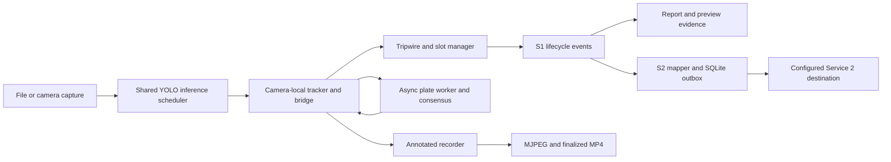

# Architecture handover

Capture and camera-local pipelines hold their own geometry, slot state, tracks and plate jobs. The multicamera scheduler batches compatible inference and isolates per-camera faults. The detector returns boxes, confidence and class. ByteTracker associates detections within one camera. Shared ReID and handoff are optional. Geometry can be scaled from calibration dimensions; the slot manager arbitrates overlap and reservations and updates parking state independently of OCR.

The per-camera path reads calibration through `s1/parking/slot_geometry.py` and updates assignments through `s1/parking/slot_manager.py`. `s1/parking/parking_lifecycle.py` evaluates parking transitions from the available observations. Unavailable occupancy evidence can yield UNKNOWN. A missed plate does not prevent slot tracking.

`s1/vehicle_front/plate_recognition.py` reads plate evidence, with candidate validation in `plate_validation.py`. `vehicle_attributes.py` estimates attributes independently of plate confirmation. Missing or ambiguous values remain unavailable or unconfirmed in the resulting records. See [configuration](CONFIGURATION_REFERENCE.md) for the per-camera calibration and model settings and [diagnostics](ERROR_HANDLING.md) for recovery boundaries.

The bridge owns track-to-vehicle evidence association and builds raw ENTRY, PARK_START, PARK_END, EXIT and update envelopes. The S2 mapper remembers gate ENTRY and turns PARK_START into mapped ENTRY. PARK_END closes a matching parked record and generates mapped EXIT. Gate EXIT remains internal. The mapper preserves event, observed and capture time fields for the existing contracts. Plate data is withheld for unconfirmed candidates. Reports and annotated video preserve partial results; reports are replaced atomically.

The SQLite outbox is the durable sender queue. The mapper separately tracks camera/area lifecycle sessions and canonical park-start IDs. Queue acceptance and destination acknowledgement are distinct. The API starts one worker per process, exposes health and job state, and can stream video when the multicamera demo recorder is enabled. Runtime entry points are `main.py`, `run_local.py`, and `s1.api:app`.

See [API reference](API_SWAGGER.md) and the [lifecycle audit](../TEST_REPORTS/BROADER_EVENT_LIFECYCLE_AUDIT_REPORT.md).
