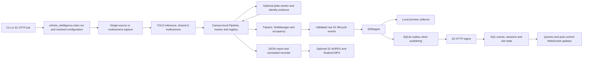

# Smart Parking S1 + S2 master engineering handover

**Verified implementation baseline:** `8b9f1b3e90f9b5098c424fd5c97746fac8a4924a`

**Readiness:** Ready for engineering ownership and controlled staging. Production acceptance depends on site calibration, representative cameras and models, destination database and credentials, and measured reliability under site load.

## A. Executive overview

Smart Parking observes vehicles in calibrated video, maintains camera-local occupancy, and records parking lifecycle evidence. The engineering challenge is to preserve useful state as vehicles cross camera views, detections become intermittent, plate evidence arrives late, and downstream delivery fails independently.

**S1 owns observation.** It accepts recorded or live sources, produces detections, tracks and optional plate and attribute evidence, applies calibrated tripwires and slot geometry, and creates raw events, reports, and optional annotated video. Its HTTP service runs one source per job and supports status, cancellation and video retrieval.

**S2 owns ingestion and data management.** It receives eligible parking events, validates them against the target database, updates event/session/slot data, and exposes operational queries and a WebSocket. Local S1 output is useful in preview mode without a remote S2 service.

The handover includes configuration-driven camera and slot state, optional model-backed evidence, shared inference scheduling, a durable sender, guarded partial output, and a verified HTTP contract. The most recent run recorded 202 regression passes. The outstanding acceptance work is listed in [N. Known limitations](#n-known-limitations-and-pending-acceptance).

## B. System architecture



The YAML selects a single-source or calibrated multicamera path. The multicamera runner owns capture runtimes and batches compatible work through a shared detector. Each camera retains independent timing, tracking, geometry and occupancy. Motion gating, frame aging, and heartbeat checks limit unnecessary inference without requiring continuous visible motion. Optional plate and ReID work is correlated back to camera observations. Sync replay is available for controlled recordings; realtime capture may drop frames to stay current.

The S1 API holds a latest-job snapshot, worker and cancellation state per process. It runs an upload or live source through the same S1 runtime. S2 is a distinct FastAPI application using SQLAlchemy sessions and database lookups. Its socket registry is also process-local. CPU is the verified reference; detector, OCR and auxiliary providers need separate validation on other hardware. [Published architecture](../ARCHITECTURE_HANDOVER.md)

## C. Trace a vehicle end to end

This describes the normal eligible trajectory. A single observed vehicle can produce only a subset of the lifecycle.

| Step | Operation and output | If evidence or processing fails |
|---|---|---|
| 1. Open source | Resolve YAML, validate camera entries and load geometry for the opened source. A frame carries image, index and time. | An unusable camera can be isolated in multicamera. No usable camera is a job failure. |
| 2. Detect and track | The detector supplies boxes, scores and classes. ByteTracker associates them into camera-local tracks and reports removals. | Valid empty detections age tracks. A failed inference or malformed update is diagnosed separately and does not become a trustworthy empty observation. |
| 3. Associate a vehicle | The bridge binds the track to a registry UID, aggregates class/color and can request shared identity evidence. | Weak identity evidence remains unresolved. Local parking can continue independently of cross-camera matching. |
| 4. Collect plate evidence | Eligible vehicle crops go through quality checks, plate detection, OCR and consensus. The worker returns a keyed result. | Rejected crops, weak reads and expired evidence can leave a null or unconfirmed plate. Late results must still match their vehicle. |
| 5. Evaluate gate and bay | Tripwire uses calibrated side and motion evidence. The slot manager evaluates contact point, footprint overlap, reservations and dwell. | Ambiguity can leave a vehicle unassigned. Missing observations can leave occupancy UNKNOWN. |
| 6. Build lifecycle | A qualified crossing can yield ENTRY, a stable eligible bay PARK_START, a qualified departure PARK_END, and an outward observation EXIT. The bridge attaches relevant time, identity, parking and snapshot evidence. | Invalid envelopes are withheld. Incomplete histories remain visible in reports. |
| 7. Map and deliver | The mapper remembers the arrival context, maps eligible PARK_START/PARK_END to S2 ENTRY/EXIT, and enqueues delivery when enabled. S2 validates and commits the transaction. | Unsafe or stale mappings can be withheld. An unsuccessful send can leave pending work. Queue, HTTP acknowledgement and committed DB state have separate meanings. |
| 8. Finalize outputs | S1 writes the JSON report and optional annotated MP4. The API records terminal state, closes preview and makes eligible output available. | Cancellation may leave a playable partial clip. An invalid recording or failed report write must be investigated before using the output. |

[Published processing guide](../END_TO_END.md)

## D. Module breakdown and ownership

| Implementation path | Responsibility |
|---|---|
| [main.py](../../main.py), [vehicle_intelligence/main.py](../../vehicle_intelligence/main.py), [run_local.py](../../run_local.py), [preflight.py](../../preflight.py) | Entrypoints, input preparation, runtime selection and readiness checks. |
| [vehicle_intelligence/common](../../vehicle_intelligence/common) | YAML merge/validation, frame model, diagnostics, logging and evidence protection. |
| [vehicle_intelligence/video/grabber.py](../../vehicle_intelligence/video/grabber.py), [vehicle_intelligence/multicam/multicam.py](../../vehicle_intelligence/multicam/multicam.py) | Sequential or realtime sources, event evidence buffering, camera runtimes and shared scheduling. |
| [vehicle_intelligence/vehicle_front](../../vehicle_intelligence/vehicle_front) | YOLO/YOLOX adapters, ByteTracker, vehicle records, plate processing, color, embeddings and global identity. The verified runner uses `YoloDetector`. |
| [vehicle_intelligence/parking](../../vehicle_intelligence/parking) | Geometry, tripwire, slot assignment, occupancy, motion handling, restore and lifecycle projection. `Tripwire` and `SlotManager` are implemented in `logic.py`. |
| [vehicle_intelligence/integration](../../vehicle_intelligence/integration), [vehicle_intelligence/events/event_manager.py](../../vehicle_intelligence/events/event_manager.py) | `Pipeline` in the vehicle-parking bridge owns frame-to-event orchestration. Flow controls motion gating, auxiliary inference and handoff. The event manager builds and validates envelopes. |
| [vehicle_intelligence/publishing](../../vehicle_intelligence/publishing) | `S2Mapper`, durable `Outbox` and optional snapshot upload. |
| [vehicle_intelligence/reporting/report.py](../../vehicle_intelligence/reporting/report.py), [vehicle_intelligence/video/demo_video.py](../../vehicle_intelligence/video/demo_video.py) | Report assembly and safe replacement, composed overlays, preview and validated file finalization. |
| [vehicle_intelligence/api.py](../../vehicle_intelligence/api.py) | FastAPI endpoints, schemas, structured request errors, job thread, GET/HEAD video and lifespan shutdown. |
| [parking_management/app](../../parking_management/app) | FastAPI routers, ingestion, database sessions, auth, cryptography, data queries and WebSocket notifications. |

Several top-level S1 modules and submodule names re-export existing implementations through [vehicle_intelligence/_compat.py](../../vehicle_intelligence/_compat.py). Modify the implementation owner when extending a component; identity and parking state belong to the camera pipeline, while remote delivery belongs to the mapper and outbox. See the local module reference and the [published boundary map](../MODULE_BOUNDARIES.md).

## E. Parking logic and lifecycle

“Slot discovery” is loading calibrated slots from geometry. The normal runtime does not infer new parking bays from images. [Geometry](../../vehicle_intelligence/parking/slot_geometry.py) loads slot IDs, polygons, tripwire and interior point; calibration dimensions allow scaling to actual frame size. Each configured source must use the appropriate geometry.

A track supplies ground-contact and footprint evidence. [SlotManager](../../vehicle_intelligence/parking/logic.py) arbitrates overlap, reservations and candidate stability. Boundary, movement, dwell and loss windows reduce transitions caused by brief gaps. A consistent stationary opening observation can produce a baseline occupant tagged `INITIAL_SCAN` without inventing an arrival. A later eligible parked vehicle and a qualifying departure follow different paths. Confirmed occupied, observed free and UNKNOWN carry distinct meaning; an unprocessed camera must not be interpreted as free. Clear or reassign a bay only when its transition rules support doing so.

Gate ENTRY and EXIT are raw evidence about crossing the area boundary. PARK_START and PARK_END concern a bay session and drive the mapped S2 boundary. The bridge tracks camera, UID, slot and time; the mapper can reject stale or conflicting associations. The [lifecycle projection](../../vehicle_intelligence/parking/parking_lifecycle.py) summarizes the available sequence. Identical inputs and controlled replay improve repeatability. Contact ambiguity, occlusion and identity remain heuristic and need site acceptance. [Lifecycle audit](../../TEST_REPORTS/BROADER_EVENT_LIFECYCLE_AUDIT_REPORT.md)

## F. Vehicle intelligence

[Detection](../../vehicle_intelligence/vehicle_front/detection.py) supplies vehicle boxes, classes and confidence. [Tracking](../../vehicle_intelligence/vehicle_front/tracking.py) uses two score bands, IoU and track age. [VehicleRegistry](../../vehicle_intelligence/vehicle_front/vehicle_service.py) maps local tracks to observed vehicle records; a track number is scoped to its camera/tracker lifetime.

[PlateReader, PlateWorker and PlateVoter](../../vehicle_intelligence/vehicle_front/plate_recognition.py) gate crops by quality, run the configured plate and OCR models, and use repeated reads and confidence for consensus. The live worker uses a bounded input queue and returns keyed results. The pipeline correlates results to vehicle evidence before confirmation. A missing or unconfirmed plate remains distinguishable from a confirmed read. Vehicle type is aggregated from detector classes; color is estimated from crop pixels by [vehicle attributes](../../vehicle_intelligence/vehicle_front/vehicle_attributes.py). Missing attributes remain unavailable.

[ReID and handoff](../../vehicle_intelligence/integration/flow.py) can associate optional OSNet or histogram evidence across views. Appearance, clock and geometry ambiguity limit association reliability. Keyed async work and bounded waits keep local processing independent of late evidence. Real OSNet and live plate accuracy are unverified. The [historical B-03 audit](../../TEST_REPORTS/B03_PLATE_ASSOCIATION_AUDIT.md) remains inconclusive.

## G. S1–S2 integration

[build_event and validate_event](../../vehicle_intelligence/events/event_manager.py) produce the raw S1 v1 envelope and check required identity/time/slot fields. [S2Mapper](../../vehicle_intelligence/publishing/s2_mapper.py) translates eligible PARK_START to S2 ENTRY and PARK_END to S2 EXIT. Gate EXIT does not independently create a second mapped exit. Mapped `timestamp`, `captured_at` and `received_at` represent first-seen, parked and applicable leave time. Preserve source-event timing when auditing a journey.

[S2 VehicleEvent](../../parking_management/app/schemas/vehicle_event.py) carries event type, camera, area, timestamp, vehicle attributes and optional identity, parking and snapshots. The receiver also requires a usable identity and slot for ENTRY/EXIT and resolves registered lookup data. [Ingest](../../parking_management/app/routes/events.py) checks duplicates and session consistency, commits event/session/occupancy updates, then broadcasts. Authenticated protected routes require the configured API key. Plate storage uses encrypted values and keyed lookup.

[Outbox](../../vehicle_intelligence/publishing/outbox.py) encrypts SQLite payloads and retries eligible failures with exponential backoff capped at 60 seconds. The sender treats HTTP 409 as acknowledged; the receiver can return 409 for a rolled-back conflict. Confirm target DB state during recovery. The system has no general exactly-once guarantee. [Mapper regression](../../tests/regression/test_s2_mapper_exit.py), [S2 deduplication fixtures](../../parking_management/tests/test_event_dedup_security.py) and isolated sender tests support the verified behavior. Production DB, authentication, network partitions and external snapshot acceptance remain site work.

## H. API and operational interface

[S1 FastAPI](../../vehicle_intelligence/api.py) declares the following application operations. Consult the [published HTTP guide](../API_SWAGGER.md) and [OpenAPI snapshot](../openapi.json) for field-level contracts and curl examples.

| Method and path | Input and result |
|---|---|
| GET `/` | 200 service links. |
| GET `/health` | 200 process liveness. |
| GET `/api/status` | 200 current/latest job state, worker liveness, output links and optional diagnostic. |
| POST `/api/upload` | Multipart `file`, optional `replay` and `no_plates` query options. 202 starts a job; 400, 409, 413, 415, 422 or 500 cover rejection paths. |
| POST `/api/live/start` | JSON `source` index string or RTSP(S) URL, optional replay and plate settings. 202 acceptance; 400, 409, 422 or 500 for errors. |
| POST `/api/live/stop` | 200 cancellation request or current state. Poll for cleanup. |
| GET `/api/video/uploaded` | 200 file names and sizes, or 500 if inventory access fails. |
| GET `/api/frames/latest` | 501, explicitly unimplemented. |
| GET and HEAD `/api/output/stream` | Final MP4 by default, MJPEG for `live=true`. 200 or 206 for eligible content; 400 malformed range, 404 unavailable, 409 pending, 416 unsatisfiable, 422 invalid query or 500 storage error. |

A 202 means acceptance, while a later worker failure appears in status with HTTP 200. States include idle, starting, running, cancelling, cancelled, completed and error. Wait for a terminal state and `worker_alive: false`. Finalized MP4 supports byte ranges; HEAD has no body and returns representation headers. Live HEAD omits length and byte-range headers. Unsatisfiable MP4 range returns an empty response and `Content-Range: bytes */<size>`. Live preview is latest-frame MJPEG and can skip frames; it closes when the job ends. One worker slot and the latest output pointer live in memory, per process. The app uses the first configured calibrated camera for a multi-entry YAML. Swagger, ReDoc and live schema are at `/docs`, `/redoc` and `/openapi.json`. S1 needs upstream authentication and access controls for deployment.

[S2 routes](../../parking_management/app/main.py) are separate from the S1 schema. S2 exposes GET `/health`, GET `/health/database`, POST `/internal/events/vehicle`, POST `/internal/geometry/slots`, GET `/api/occupancy`, GET `/api/analytics/summary`, GET `/api/vehicles/{plate_number}`, GET `/api/snapshots/vehicle/{plate_number}`, and WebSocket `/ws/parking`. Ingest, geometry, vehicle lookup and snapshot lookup require `X-API-Key`. The socket uses the configured `WS_TOKEN` through the token query parameter. The database probe reports health in its body; use it with platform DB monitoring.

## I. Installation and deployment

The exercised baseline was Linux x86-64, Python 3.12.14, CPU PyTorch, OpenCV and FFmpeg. The project requires Python 3.10 or newer. The documented ML setup targets 3.10–3.12; evaluate wheel and provider availability on the target. There is no validated minimum RAM, core count or camera density. Size storage for recordings, retained media, reports and SQLite, then measure host capacity on representative streams.

From the repository root, provision a virtual environment and use [the installation guide](../INSTALLATION_GUIDE.md) for CPU PyTorch and [development requirements](../../requirements-dev.txt). Use [Windows instructions](../../INSTALL_WINDOWS.md) or an approved CUDA/PyTorch combination with [GPU requirements](../../requirements-gpu.txt) as reference workflows. Fresh installation, Windows and GPU were outside the latest audit. The bundled detector weights are selected by the local YAML. Supply separately approved ALPR/OSNet models, source media and camera calibration as needed. Avoid mixed ONNX Runtime providers.

Run preflight per camera. Start S1 preview without external publishing. For S2 provision its own dependencies, a compatible DB schema and lookup rows, `DATABASE_URL`, auth and key material. Its SQLite tests do not bootstrap a production database. See the [configuration reference](../CONFIGURATION_REFERENCE.md) and [S2 dependencies](../../parking_management/requirements.txt).

## J. Reliability and error handling

| Boundary | Mechanism and operator implication |
|---|---|
| Config/camera | Configuration and shape checks fail early; per-camera source or geometry failures can be isolated if another camera remains viable. |
| Frame and identity | Invalid or backwards observations are rejected. Tracking, OCR and attributes have separate failure boundaries. Unconfirmed evidence may persist while parking continues. |
| Lifecycle | Validated IDs, time and slot fields, local matching, held events and session checks reduce invalid or duplicate transitions. Missing evidence can produce partial results. |
| Persistence | Temporary writes and atomic report replacement can preserve a previous result. Video is checked for playability before replacing valid media. |
| Delivery | Encrypted queue, timeout and retry delay keep network sends separate from inference. Investigate remote conflicts and reconcile queue and receiver state. |
| HTTP and shutdown | Structured errors omit internal payloads. Job stop is cooperative. Lifespan signals cancellation and waits up to 30 seconds, then can log `API_SHUTDOWN_TIMEOUT`. Native operations can delay cleanup. |

[Diagnostic](../../vehicle_intelligence/common/errors.py) includes component, code, operation, severity, context and recovery information. CLI rotating logs and error ledger expose warnings/errors by component. Trace failures from the first bad camera/frame or job diagnostic to the last valid state. The [published reliability guide](../ERROR_HANDLING.md), [code registry](../ERROR_CODE_REGISTRY.md) and [fault-injection report](../../TEST_REPORTS/ERROR_HANDLING_AND_FAULT_INJECTION_REPORT.md) describe specific recovery evidence.

## K. Testing and validation

The latest recorded audit used Python 3.12.14, FastAPI 0.141.1, Starlette 1.6.0, isolated SQLite for S2, and external publishing disabled. Tests were not rerun for this document.

| Recorded run | Passed | Failed | Errors | Skipped | Blocked |
|---|---:|---:|---:|---:|---:|
| Complete S1 regression | 174 | 0 | 0 | 0 | 0 |
| Complete S2 regression | 28 | 0 | 0 | 0 | 0 |
| Targeted API, cancellation and fault suite, included in S1 | 80 | 0 | 0 | 0 | 0 |
| Isolated Uvicorn HTTP checks | 44 | 0 | 0 | 0 | 0 |
| OpenAPI, Swagger and ReDoc checks | 10 | 0 | 0 | 0 | 0 |

S1 unit tests exercise geometry, baseline and overlap rules. Integration, production scenarios and regression cover lifecycle, camera isolation, report integrity, renderer, cancellation, API and publishing fixtures. S2 tests cover auth, geometry, lookup, event deduplication/exit behavior and security against controlled state. The loopback harness used synthetic recorded input, checked media decode and ranges, and loaded documentation UIs in Chromium. The portable Linux CPU preview wrote a report; historical recorded-media tracking probes are qualitative and have no labelled ground truth. The original 200-case release recorded 61% S1 coverage; that is historical, and the latest 202-case audit has no new coverage measurement.

[Latest audit](../../TEST_REPORTS/API_AUDIT_REPORT.md) · [Machine-readable evidence](../../TEST_REPORTS/raw/api-finalization/results.json) · [Reproduction commands](../../TEST_REPORTS/FINAL_REPRODUCTION_COMMANDS.md)

## L. Repository, packaging and recovery

`vehicle_intelligence/` and `parking_management/` are runtime sources. `config/` contains templates, `data/` sample calibrated geometry, `models/` placement notes, and `videos/` local input placement. `tests/` and `parking_management/tests/` hold distinct suites. `scripts/` and `tools/` support calibration and validation. `docs/` contains operating guides and OpenAPI, while `TEST_REPORTS/` holds current and historical evidence. The root detector weights are bundled; site footage, model variants, credentials and the production DB are provisioned separately.

The [existing archive checksum](../../TEST_REPORTS/raw/SMART_PARKING_S1_PRODUCTION_HANDOVER_FINAL.zip.sha256) and [member inventory](../../TEST_REPORTS/raw/original_zip_member_sha256.json) belong to the earlier verified handover ZIP. That archive predates the byte-range and API audit commits. Verify it against its own checksum. Use commit identity for the current repository. Full repository distributions carry S2, configs and evidence; the wheel configuration selects S1 Python packages. Back up matching release, YAML/calibration, state DBs and managed key IDs together. [Historical packaging verification](../../TEST_REPORTS/PACKAGING_VERIFICATION.md)

## M. Operator workflow

1. Provision the reference environment or qualify the target provider. Confirm detector and auxiliary model paths.
2. Copy the appropriate configuration and set source, calibration, writable directories and replay policy. Keep publishing off until staging acceptance.
3. Run preflight and review each camera result. A single ready camera does not establish that all cameras are ready.
4. Run the portable file preview below, or start one S1 Uvicorn process using the [API guide](../API_SWAGGER.md). Select actual authorized sources only after the preview succeeds.
5. Observe job state, inference/capture diagnostics and timestamps. Compare a missed observation with valid empty detection behavior.
6. Review JSON report, per-camera health, lifecycle, UNKNOWN status and any annotated video. Check output age and decode before relying on it.
7. Investigate by matching job, camera, frame, UID and slot. Use the outbox and receiver logs for delivery issues.
8. Stop CLI through normal interrupt or send `POST /api/live/stop`. Wait for worker release and use the last usable report/video to assess cancellation.
9. Recover from a known good backup and fix the affected boundary. Preserve incomplete evidence and reconcile accepted events before replay.

The following recorded CPU smoke path was executed during the API audit from a provisioned environment.

```bash
RUN_DIR="$(mktemp -d)"
python scripts/make_handover_config.py \
  --source TEST_REPORTS/raw/http/cancelled-output.mp4 \
  --output "$RUN_DIR/preview.yaml"
python preflight.py "$RUN_DIR/preview.yaml"
python main.py --config "$RUN_DIR/preview.yaml" --no-publisher --no-plates
```

[Published operations guide](../PRODUCTION_OPERATIONS_GUIDE.md) · [Troubleshooting matrix](../TROUBLESHOOTING.md)

## N. Known limitations and pending acceptance

- **Implemented:** Calibrated file and live-source paths, optional ALPR/ReID, one-source HTTP jobs, multicamera CLI, asynchronous evidence, optional external publishing and transactional S2 ingestion.
- **Demonstrated:** Linux CPU preview and synthetic/recorded verification, fixture lifecycle and fault recovery, isolated S2 storage tests, loopback HTTP and rendered documentation. Historical media confirms sampled behavior and supplies no formal detection/identity metrics.
- **Pending:** Physical cameras and RTSP reliability, live ANPR and OSNet identity truth, Windows/CUDA, large and sustained camera counts, deployment security and retention, target S2 schema/persistence, external storage and destination acceptance. The B-03 association remains inconclusive. Native calls can delay stop; delivery acknowledgement needs reconciliation.

## O. Engineering decisions

Configuration-driven geometry makes one codebase usable across calibrated views. Camera-local state limits shared failures; shared detector inference reduces repeated model work. Weak OCR does not gate all occupancy work. Raw observation events and mapped S2 parking events preserve different meanings. Durable queued sending isolates remote instability but introduces reconciliation. A lightweight in-process API is appropriate for the verified single-job use case; persistent orchestration and multi-worker coordination would be separate work. Temporary output, positive playability checks and partial-report flags protect previously valid artifacts. Verification uses isolated synthetic and recorded evidence before site trials. [Design boundaries](../MODULE_BOUNDARIES.md) · [Readiness evidence](../../TEST_REPORTS/PRODUCTION_HANDOVER_READINESS_REPORT.md)

## P. Developer continuation

Start in `vehicle_intelligence.main.run`, then follow camera scheduling and `Pipeline.process`. To trace a vehicle, correlate camera, frame, track ID, UID, plate evidence and slot. To trace delivery, follow source event time and ID into mapper session, queued ID, HTTP acknowledgement and receiver transaction. To trace a job, follow `/api/status`, worker logs and media/report finalization.

Extend the implementation owner and keep existing compatibility imports. Configuration additions need explicit defaults or documented required values and validation. Add isolated focused tests at the changed boundary, including recovery behavior, then run affected regressions and refresh the relevant contract evidence. Keep site IDs and geometry out of application logic. Preserve the baseline, sanitized evidence, reproducible commands and matching configuration/data provenance. First priorities are an owned S2 bootstrap, per-camera site acceptance, measured load and explicit retry/recovery exercises.

## Q. Documentation navigation

The table maps handover topics to the guides and evidence available in this repository.

| Topic | Repository reference |
|---|---|
| Role-based index | [Project README](../../README.md) |
| 01 System architecture | [Architecture handover](../ARCHITECTURE_HANDOVER.md) |
| 02 Module reference | [Module boundaries](../MODULE_BOUNDARIES.md) |
| 03 End-to-end workflow | [End-to-end technical guide](../END_TO_END.md) |
| 04 Parking and lifecycle | [Lifecycle audit](../../TEST_REPORTS/BROADER_EVENT_LIFECYCLE_AUDIT_REPORT.md) |
| 05 Vehicle intelligence | [Detection/tracking evidence](../../TEST_REPORTS/DETECTION_TRACKING_VALIDATION_REPORT.md) |
| 06 Multicamera and video | [Architecture handover](../ARCHITECTURE_HANDOVER.md) |
| 07 S1/S2 integration | [Lifecycle audit](../../TEST_REPORTS/BROADER_EVENT_LIFECYCLE_AUDIT_REPORT.md) |
| 08 API and HTTP | [API and Swagger](../API_SWAGGER.md) |
| 09 Configuration reference | [Configuration reference](../CONFIGURATION_REFERENCE.md) |
| 10 Installation and setup | [Installation guide](../INSTALLATION_GUIDE.md) |
| 11 Error handling and reliability | [Error handling](../ERROR_HANDLING.md) |
| 12 Testing and validation | [Latest verification](../../TEST_REPORTS/API_AUDIT_REPORT.md) |
| 13 Packaging and repository | [Packaging verification](../../TEST_REPORTS/PACKAGING_VERIFICATION.md) |
| 14 Operations and troubleshooting | [Operations](../PRODUCTION_OPERATIONS_GUIDE.md) |
| 15 Engineering decisions and limitations | [Readiness report](../../TEST_REPORTS/PRODUCTION_HANDOVER_READINESS_REPORT.md) |
| 16 Developer continuation | [Module boundaries](../MODULE_BOUNDARIES.md) |
